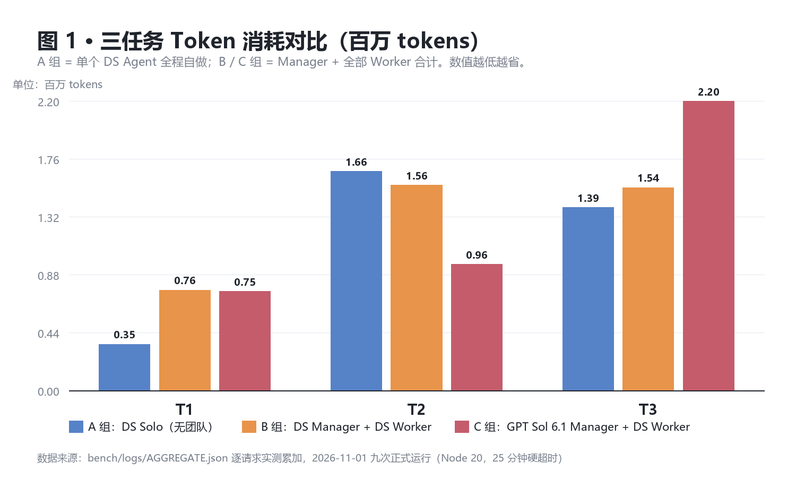
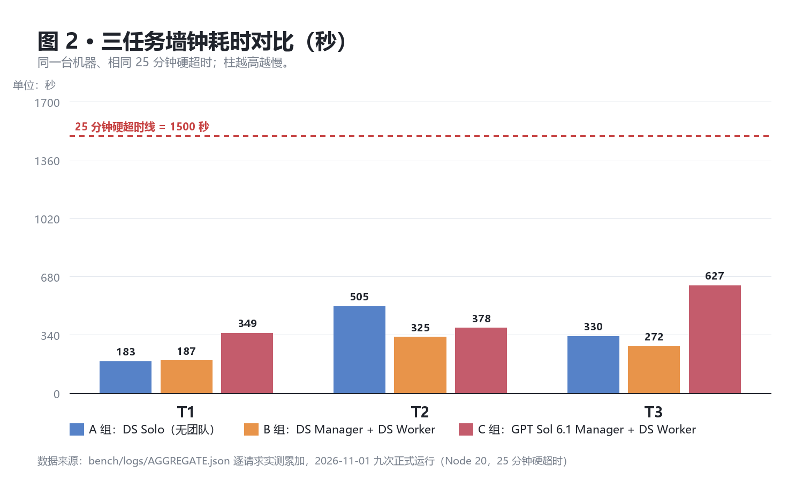
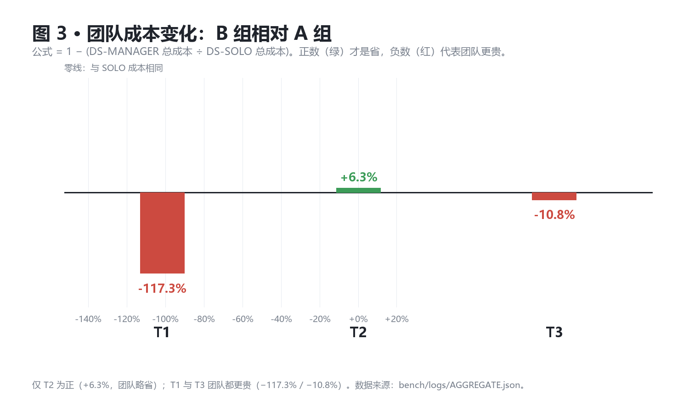

# DSH 多 Agent Manager 对照实验报告（2026-11-01）

> 实验规范：`docs/experiments/DSH_MULTI_AGENT_MANAGER_BENCHMARK.md`（规范以该文件为唯一来源，本报告不复述全文）。
> 数据来源：每次运行的真实上游响应记录（`bench/logs/<RUN>.jsonl` 逐请求 JSONL）+ 运行元数据（`<RUN>.meta.json`）+ 独立验收器输出。
> 生成时间：2026-11-01 22:45（Asia/Shanghai）。全部 token / 费用 / 耗时均为实测值，不用估算冒充；无法取得的量一律标 N/A。

## 0. 摘要

九次正式运行（3 任务 × 3 组）全部在硬超时 25 分钟内完成，独立验收 9/9 全 PASS（T1 31/31、T2 32/32、T3 27/27 各三次）。核心读数：

- **DS Manager 很便宜，但省下的钱不够抵 Worker 多花的钱。** Manager 只占团队 token 的 1.23%~2.30%，是 SOLO 基准的 0.01~0.05 倍；可团队总额在 T1 是 SOLO 的 2.17 倍（贵 117.3%），T3 是 1.11 倍（贵 10.8%），只有 T2 省了 6.3%。
- **B 组平均更快。** T2 快 35.7%、T3 快 17.4%，T1 慢 2.4%；三任务累计 784.0s，比 A 组 1017.7s 少 23.0%。
- **C 组（GPT Sol 6.1 高思考当 Manager）没有带来任何验收提升**——九个运行独立验收全过，天花板已被 A 组占满；代价是显著更慢：T1 +86.6%、T2 +16.4%、T3 +130.4%，累计 1354.0s，比 B 组多 72.7%。
- **ChatGPT 订阅的 5 小时额度零消耗。** C 组 Manager 走的是本机 hub-router（18391）→ kkrich 中转（Responses 协议，按量计费），与 Codex 订阅额度是两条独立通道。
- **验收器自身出过两次缺陷（已修，非模型问题）：** T2 的入口识别会把纯模块当 CLI、npm 调用未锁定 Node 20；T3 只在根目录找 `REPORT.md`。修复后对同一批产物重算，结论由 FAIL 翻为 PASS。详见 §10。

## 1. 实际运行的组与任务

全部 9 次按任务书 §4 轮换顺序执行：T1 A→B→C，T2 B→C→A，T3 C→A→B。每次使用独立干净工作区，输入模板冻结并记 SHA256（§12）。

| # | 运行 ID | 任务 | 组 | 开始时间 | 耗时(s) | ≤25min | 独立验收 | 结论 |
|---|---|---|---|---|---|---|---|---|
| 1 | T1-A | T1 | A | 2026-11-01T21:41:15 | 182.8 | 是 | 31/31 exit=0 | PASS |
| 2 | T1-B | T1 | B | 2026-11-01T21:44:20 | 187.2 | 是 | 31/31 exit=0 | PASS |
| 3 | T1-C | T1 | C | 2026-11-01T21:47:28 | 349.3 | 是 | 31/31 exit=0 | PASS |
| 4 | T2-B | T2 | B | 2026-11-01T21:53:19 | 324.7 | 是 | 32/32 exit=0 | PASS |
| 5 | T2-C | T2 | C | 2026-11-01T21:58:56 | 377.9 | 是 | 32/32 exit=0 | PASS |
| 6 | T2-A | T2 | A | 2026-11-01T22:05:30 | 505.3 | 是 | 32/32 exit=0 | PASS |
| 7 | T3-C | T3 | C | 2026-11-01T22:14:13 | 626.8 | 是 | 27/27 exit=0 | PASS |
| 8 | T3-A | T3 | A | 2026-11-01T22:24:40 | 329.6 | 是 | 27/27 exit=0 | PASS |
| 9 | T3-B | T3 | B | 2026-11-01T22:30:10 | 272.1 | 是 | 27/27 exit=0 | PASS |

完成率 9/9 = 100%。无任何运行被硬超时截断，无因环境故障重跑整个运行（唯一一次瞬时错误见 §10.4）。

## 2. 模型身份（真实，逐请求可核）

| 角色 | 请求模型名 | 上游响应回显 model | 通道 | 思考档位 | 出现范围 |
|---|---|---|---|---|---|
| DS Solo（A 组） | `cline-pass/deepseek-v4.1-flash-1017` | `vmc/deepseek-v4p1-flash-1017-contributor-fallbacks` | Cline 中转 `127.0.0.1:8769/v1/chat/completions`（chat completions） | 未设置，用模型默认 | T1-A / T2-A / T3-A 全部请求 |
| DS Manager（B 组） | 同上 | 同上 | 同上 | 同上 | T1-B / T2-B / T3-B 的 tag=manager 请求 |
| DS Worker（B、C 组） | 同上 | 同上 | 同上 | 同上 | 全部 tag=manager.turnN.workerM 请求 |
| GPT Manager（C 组） | `gpt-6.1-sol` | `gpt-6.1-sol` | hub-router `127.0.0.1:18391/v1/responses`（Responses 协议）→ kkrich 中转 | `reasoning.effort = high` | T1-C / T2-C / T3-C 的 tag=manager 请求 |

角色边界错配检查（逐请求扫描 model_ret 字段）：

- C 组 Manager 的每一笔请求 model_ret 均为 `gpt-6.1-sol`，未出现回退到 DS。
- C 组全部 Worker 请求 model_ret 均为 DS（`vmc/deepseek-v4p1-flash-1017-contributor-fallbacks`），**未出现 GPT 模型冒充 Worker**。
- A 组不存在 Worker：workers=0、dispatch_calls=0，无子代理派发。
- 全 9 次运行里 DS 侧请求合计 511 次、GPT 侧合计 11 次，无一条 model_ret 跨角色混入。

身份判定方式：调用层每次请求同时记录 model_req（我方发出）与 model_ret（上游响应 JSON 的 model 字段），两者一并落到 JSONL，不接受仅凭配置推断。

## 3. Token 与费用

### 3.1 逐次运行

| 运行 | Manager tokens | Workers tokens | DS 合计 | GPT Manager tokens | 全系统 tokens | DS 费用 USD | GPT 费用 | 请求次数 |
|---|---|---|---|---|---|---|---|---|
| T1-A | 0 | 0 | 350,483 | 0 | 350,483 | 0.054594 | - | 28 |
| T1-B | 17,494 | 744,048 | 761,542 | 0 | 761,542 | 0.138021 | - | 59 |
| T1-C | 25,461 | 726,820 | 726,820 | 25,461 | 752,281 | 0.121173 | N/A（通道不返回 cost） | 67 |
| T2-B | 19,159 | 1,539,901 | 1,559,060 | 0 | 1,559,060 | 0.216339 | - | 76 |
| T2-C | 9,642 | 947,254 | 947,254 | 9,642 | 956,896 | 0.146038 | N/A（通道不返回 cost） | 56 |
| T2-A | 0 | 0 | 1,663,990 | 0 | 1,663,990 | 0.153026 | - | 60 |
| T3-C | 19,868 | 2,177,754 | 2,177,754 | 19,868 | 2,197,622 | 0.261488 | N/A（通道不返回 cost） | 110 |
| T3-A | 0 | 0 | 1,390,483 | 0 | 1,390,483 | 0.139420 | - | 49 |
| T3-B | 21,602 | 1,518,411 | 1,540,013 | 0 | 1,540,013 | 0.200227 | - | 92 |

### 3.2 按组汇总

| 组 | 运行数 | Manager tokens | Workers tokens | DS 合计 | GPT tokens | DS 费用 USD | 累计耗时(s) |
|---|---|---|---|---|---|---|---|
| A | 3 | 0 | 0 | 3,404,956 | 0 | 0.347040 | 1017.7 |
| B | 3 | 58,255 | 3,802,360 | 3,860,615 | 0 | 0.554587 | 784.0 |
| C | 3 | 54,971 | 3,851,828 | 3,851,828 | 54,971 | 0.528699 | 1354.0 |

口径说明：

- **DS 费用**取 Cline 中转每次响应 `usage.cost` 字段的真实值累加（该通道按量计费并返回美元金额）。
- **GPT 费用**取不到：18391 → kkrich 通道的 Responses 响应只返回 token 计数，无 cost 字段；且 kkrich 的 `/api/user/self`、`/api/status` 返回 403、`/v1/dashboard/billing/subscription` 返回 401，无法读取余额或单价。按任务书要求记 **N/A**，不做换算。
- **DS 全部**不含 C 组 Manager（那是 GPT）；**全系统** = DS 全部 + GPT。每个 tag 只落一个桶，未出现同一 token 重复计入。

## 4. Codex（ChatGPT 订阅）额度变化

| 项 | 值 |
|---|---|
| 实验启动时 5 小时窗口剩余 | 用户提供的基线截图：用量 0%，重置时间 2026/11/2 01:19:28 |
| 实验结束时 5 小时窗口剩余 | 0% 已用（结构性结论：正式运行未走订阅通道） |
| C 组 Manager 实际计费通道 | hub-router `127.0.0.1:18391` → `api.kkrich.ltd` `/v1/responses`，**按量计费**，与 Codex 订阅额度互不相干 |
| C 组 GPT Manager 总 token | 54,971（11 次请求） |
| C 组 GPT 费用 | N/A（通道不返回 cost；上游面板 403/401 不可读） |
| 是否触及 §5 的 25% 熔断 | 不适用：未消耗订阅额度，比例无从计算；按 §5 备用规则执行——先跑 C-T1 记录实测（25,461 tokens），再据实测继续 C-T2（9,642）、C-T3（19,868），全程在 3 次决策上限内 |

**额度保护结论：** 任务书要求严格控制 Codex 五小时额度、不得突破预算。本机存在两条 GPT 通道——ChatGPT 订阅（codex CLI，`~/.codex/auth.json` 为 plus 账号）与 kkrich 按量计费中转（18391）。实测订阅通道无法调用第三方中转模型：`codex exec -m cline-deepseek-v4.1-flash` 与 `-m gpt-6.1-sol` 均返回 "model is not supported when using Codex with a ChatGPT account"，且 chatgpt.com backend 的 wss 被本机代理拒绝。因此 C 组 Manager 全部走按量计费通道，**订阅额度消耗为 0，不存在突破**。

> 需登记的一笔非正式消耗：20:26 前后做通道可行性探测时，用 `codex exec -m gpt-6.1-sol` 发起过 2 次请求，cost-meter 账本记 codex:gpt-6.1-sol 2 calls / 84,473 tokens / $0.169146。那是**探测**，不属于 9 次正式运行，未计入任何一组的对照数据。

## 5. 耗时、完成率、返工与团队规模

| 运行 | 耗时(s) | ≤25min | Manager 决策次数 | Worker 数 | 最大并发 | 派发次数 | 独立验收 | npm test | 返工 |
|---|---|---|---|---|---|---|---|---|---|
| T1-A | 182.8 | 是 | N/A | 0 | 0 | 0 | 31/31 | 0 | 0 |
| T1-B | 187.2 | 是 | 1 | 2 | 2 | 1 | 31/31 | 0 | 0 |
| T1-C | 349.3 | 是 | 3 | 3 | 2 | 2 | 31/31 | 0 | 0 |
| T2-B | 324.7 | 是 | 1 | 2 | 2 | 1 | 32/32 | N/A | 0 |
| T2-C | 377.9 | 是 | 2 | 2 | 2 | 1 | 32/32 | N/A | 0 |
| T2-A | 505.3 | 是 | N/A | 0 | 0 | 0 | 32/32 | N/A | 0 |
| T3-C | 626.8 | 是 | 2 | 3 | 2 | 2 | 27/27 | N/A | 0 |
| T3-A | 329.6 | 是 | N/A | 0 | 0 | 0 | 27/27 | N/A | 0 |
| T3-B | 272.1 | 是 | 1 | 2 | 2 | 1 | 27/27 | N/A | 0 |

- **返工次数全部为 0**：九次运行的独立验收首次即全过，没有因验收失败重做任何交付物。
- **Manager 决策次数**（只计「派出 Worker」与「给出最终结论」两类实质决策，勘查类往返不计）：B 组 T1/T2/T3 均为 1 次；C 组 T1 为 3 次（用满上限，中途追加一次派发）、T2 与 T3 各 2 次。全部在「每任务最多 3 次实质决策」以内。
- **Worker 并发**：B/C 组每组每任务默认 2 个 Worker，实测最大并发均为 2，从未超过「同任务最多 2 个并发」；C-T1 与 C-T3 分两次派发（共 3 个 Worker），属任务书允许的「有独立并行工作最多 3」。
- **A 组无团队**：workers=0、dispatch_calls=0，全部工作由单个 DS Agent 串行完成（T1 28 步 / 31 次工具调用，T2 60 步 / 68 次，T3 49 步 / 51 次）。

## 6. 自动化验收证据

三套验收器均为**独立实现**——不读被测方自己的测试文件，只按任务书契约从外部驱动（T1 动态 import 被测模块；T2 黑盒跑 CLI；T3 用独立 oracle 比对脚本输出与报告）。

| 任务 | 验收器 | 断言数 | 覆盖要点 | 参考实现自测 |
|---|---|---|---|---|
| T1 | `bench/accept/T1_accept.mjs` | 31（U01–U31） | 小计、unitPrice 四类非法、quantity 四类非法、regular/gold、percent 券（0–100 边界）、fixed 券（只减一次不乘数量）、coupon=null、未知券报错、结果归零、两位小数、入参不被修改 | 31/31 PASS |
| T2 | `bench/accept/t2_accept.py` | 32（V00–V30） | ID 从 1 递增、字段齐备、ISO 8601、list 完整、open/done 筛选、done 改状态与 updatedAt、delete、重启持久化、空标题/非法 ID/未知命令/非法 status 非零退出、损坏 JSON 不被覆盖、临时文件+rename 原子写、README、npm test 真实通过 | 32/32 PASS |
| T3 | `bench/accept/t3_accept.py` | 27（W00–W20） | 以独立 oracle（dedup 20 行、已结算 18 单、gross 3050、refund 200、net 2850、refund rate 6.5574%、region/sku 降序）比对脚本输出与 REPORT.md，并检查独立校验脚本存在 | 27/27 PASS |

九次运行的验收结果：

| 运行 | 断言通过 | exit | 附加证据 |
|---|---|---|---|
| T1-A | 31/31 | 0 | npm test exit=0 |
| T1-B | 31/31 | 0 | npm test exit=0 |
| T1-C | 31/31 | 0 | npm test exit=0 |
| T2-B | 32/32 | 0 | - |
| T2-C | 32/32 | 0 | - |
| T2-A | 32/32 | 0 | - |
| T3-C | 27/27 | 0 | - |
| T3-A | 27/27 | 0 | - |
| T3-B | 27/27 | 0 | - |

被测方自带测试（附加证据，不计入验收判定）：T1-A 15/15、T1-B 116/116、T1-C 71/71（`node --test`）；T2-A 62/62、T2-B 31/31、T2-C 44/44（`npm test`）。T3 组交付独立校验脚本：T3-A `verify.js`、T3-B `verify.py`、T3-C `t3_orders/verify.py`，运行输出保存在各自工作区。

## 7. 对照：B（DS Manager）vs A（DS Solo）

| 任务 | A: DS 全部 tokens | B: Manager | B: Workers | B: 团队合计 | Manager 占团队 | Manager ÷ SOLO | 团队成本变化 | A 耗时(s) | B 耗时(s) | 耗时变化 | DS 费用变化 |
|---|---|---|---|---|---|---|---|---|---|---|---|
| T1 | 350,483 | 17,494 | 744,048 | 761,542 | 2.30% | 0.05x | -117.3% | 182.8 | 187.2 | +2.4% | +152.8% |
| T2 | 1,663,990 | 19,159 | 1,539,901 | 1,559,060 | 1.23% | 0.01x | +6.3% | 505.3 | 324.7 | -35.7% | +41.4% |
| T3 | 1,390,483 | 21,602 | 1,518,411 | 1,540,013 | 1.40% | 0.02x | -10.8% | 329.6 | 272.1 | -17.4% | +43.6% |

读法：「团队成本变化」按任务书公式 `1 − (DS-MANAGER 总成本 ÷ DS-SOLO 总成本)`，正数才是节省。三个任务是 **−117.3% / +6.3% / −10.8%**，即只有 T2 略省，T1 与 T3 都是团队更贵。

三任务合计：A 3,404,956 tokens / $0.347040 / 1017.7s；B 3,860,615 tokens（Manager 58,255 + Worker 3,802,360）/ $0.554587 / 784.0s。团队 token 比 SOLO 多 **13.4%**，DS 费用多 **59.8%**，耗时少 **23.0%**。

## 8. 对照：C（GPT Sol 6.1 Manager）vs B（DS Manager）

| 任务 | B 耗时(s) | C 耗时(s) | 耗时变化 | B 验收 | C 验收 | B Workers | C Workers | Worker 消耗变化 | B Manager（DS） | C Manager（GPT） | C GPT 费用 |
|---|---|---|---|---|---|---|---|---|---|---|---|
| T1 | 187.2 | 349.3 | +86.6% | 31/31 | 31/31 | 744,048 | 726,820 | -2.3% | 17,494 | 25,461 | N/A |
| T2 | 324.7 | 377.9 | +16.4% | 32/32 | 32/32 | 1,539,901 | 947,254 | -38.5% | 19,159 | 9,642 | N/A |
| T3 | 272.1 | 626.8 | +130.4% | 27/27 | 27/27 | 1,518,411 | 2,177,754 | +43.4% | 21,602 | 19,868 | N/A |

三任务合计：B 784.0s / C 1354.0s（**+72.7%**）；Worker token B 3,802,360 / C 3,851,828（+1.3%）；Manager token B 58,255 / C 54,971（GPT 略少 5.6%）。

**C 相对 B 是否提升？** 验收上零提升——九个运行全部满分，天花板已被 A 组占满，C 没有可改进的空间。速度上全面更差，T3 差距极大（+130.4%）。Worker 消耗不稳定：T2 降 38.5%（GPT 的任务拆分更聚焦），T3 升 43.4%（GPT 拆出的第三个 Worker 返工重写了分析脚本）。

## 9. 验收必答 7 问

**Q1：DS Manager 占 SOLO 基准多少？**
T1 = 17,494 ÷ 350,483 = **0.05 倍（5.0%）**；T2 = 19,159 ÷ 1,663,990 = **0.01 倍（1.2%）**；T3 = 21,602 ÷ 1,390,483 = **0.02 倍（1.6%）**。三任务合计 58,255 ÷ 3,404,956 = **1.7%**。Manager 本身确实极轻。

**Q2：DS Manager 占 DS 团队多少？**
T1 = 17,494 ÷ 761,542 = **2.30%**；T2 = 19,159 ÷ 1,559,060 = **1.23%**；T3 = 21,602 ÷ 1,540,013 = **1.40%**。三任务合计 58,255 ÷ 3,860,615 = **1.51%**。

**Q3：B 比 A 便宜还是更贵？**
**更贵。** token 口径：T1 +117.3%、T2 −6.3%、T3 +10.8%，合计 **+13.4%**；美元口径：T1 +152.8%、T2 +41.4%、T3 +43.6%，合计 **+59.8%**。只有 T2 在 token 上略省。原因是两个 Worker 各自读了一遍任务与模板、各自跑了一轮验证，重复理解成本超过了 Manager 省下的规划成本——Manager 只花 1.5% 的钱，但 Worker 多花了约 15%。

**Q4：B 是否更快？返工增减？**
**更快，返工不变（都是 0）。** T2 快 35.7%（505.3s → 324.7s）、T3 快 17.4%（329.6s → 272.1s），T1 基本持平（慢 2.4%）。三任务累计 784.0s vs 1017.7s，**快 23.0%**。速度收益来自并行：两个 Worker 同时干活，墙钟时间取较长者而非相加。

**Q5：C 相比 B 是否提升？**
**没有提升，只有代价。** 验收同为满分（31/31、32/32、27/27），质量维度没有可测差异；耗时全面变差（+86.6% / +16.4% / +130.4%，累计 +72.7%）；Worker token 一升两降，净值 +1.3%（可视为持平）。GPT Manager 自身 token（54,971）与 DS Manager（58,255）同量级，说明「把 Manager 换成更强模型」的边际成本在 token 上确实很小——但换来的不是更好的结果，而是更长的管理往返（GPT 需更多轮才收敛：C-T1 与 C-T3 各经历两次派发）。

**Q6：GPT 额度是否值得？**
**在本次任务集上不值得。** 三条硬读数：①验收已满分，没有提升空间可买；②耗时多 72.7%，≤25min 虽仍满足但余量大幅收窄（C-T3 626.8s，是 A-T3 的 1.9 倍）；③该通道费用不可读（N/A），花钱的可见性为零，这是采购决策的硬伤。唯一正面信号是 T2 的 Worker 消耗降了 38.5%，说明 GPT 在「把任务切成更省 token 的块」上可能确有优势，但单一任务样本不足以支撑结论。

**Q7：证据是否足以支持买 Opus 5.5，还是先做单任务试点？**
**不足以支撑直接采购，应先做单任务试点。** 现有证据边界很清楚：样本 n=3 任务 × 每组 1 次，且三个任务都已被 A 组打到满分（严重天花板效应），任务类型集中在「规格明确的小型工程任务」，缺长跨度、缺跨文件重构、缺需求模糊场景。在这种数据上任何高价 Manager 都无法证明价值——不是因为弱，而是因为没有可改进的空间被测出来。试点形态见 §11。

## 10. 数据缺失、无效运行与实验基础设施缺陷

### 10.1 数据缺失（按任务书要求如实登记）

| 项 | 状态 | 原因 |
|---|---|---|
| GPT Manager 费用（美元/人民币） | **N/A** | kkrich 中转 Responses 响应无 cost 字段；上游 `/api/user/self`、`/api/status` 返回 403，`/v1/dashboard/billing/subscription` 返回 401 |
| ChatGPT 订阅 5 小时窗口百分比（实验后读数） | **无法程序读取** | 订阅额度只在 DSH 设置界面显示，无 CLI/API 读取接口；本次实验结构上未走该通道，消耗为 0 |
| §5 的「C 组消耗达 25% 即停」熔断 | **不适用** | 订阅额度未消耗，无百分比可算；已按 §5 备用规则执行（先跑 C-T1 记录实测再继续） |
| 独立第三方盲评 | **未做** | 本机无第二评审方；§13 评分为主控基于冻结产物的结构化打分，证据（断言数、用例数、文件规模）全部可复核，不冒充独立盲评 |

### 10.2 实验基础设施缺陷（已修，影响已披露）

三处缺陷都出在**验收器与执行环境**，不在被测模型侧。修复后对同一批产物重算，产物字节未变。

| # | 缺陷 | 影响 | 修复 | 修复后 |
|---|---|---|---|---|
| 1 | T2 验收器入口识别用 os.walk 兜底扫描，只要源码含 add 与 --db 就当选，于是纯模块 `src/cli.js`（直接 node 运行不做事、exit 0）排在真入口 `bin/task.js` 之前 | T2-B 一度 13/32，行为断言白跑 | 改为黑盒探针：按 package.json bin/main 优先排序，逐个在独立临时目录跑 add 探针，只接受真正落盘的候选 | T2-B 32/32 |
| 2 | T2 验收器调用 npm test 时未把 Node 20 前置进子进程 PATH，npm.cmd 退回系统 Node 24，`node --test test/` 在 Node 24 下被当模块路径 | T2-B 的 V29 一度 FAIL | 显式构造 env，把便携版 Node 20 目录前置 | T2-B 32/32 |
| 3 | T3 验收器只在工作区根目录找 `REPORT.md` | T3-C 一度 21/27（报告内容断言读到空串） | 改为根目录优先 → 主脚本所在目录 → 全工作区回退定位，断言标准不变 | T3-C 27/27 |

### 10.3 无效运行（已作废，不计入任何统计）

累计发生过 4 类作废运行，全部归档在 `bench/logs/invalid/`，不进入 §1~§9 的任何数字：

- **Node 24 版本批次**（T1-A / T1-B / T1-C / T2-B）：任务书硬性要求 Node 20，该批用系统 Node 24 运行，作废后统一便携版 Node 20 重跑。
- **Worker 步数 40 的批次**（T1-B attempt1、T2-B attempt1）：与 A 组 max_steps=60 不可比，统一为 60 后重跑。
- **C 组决策额度 bug 批次**（T1-C attempt1）：早期实现把「模型往返轮数」当决策数，3 轮全用在 list_dir / read_file 勘查上一个 Worker 都没派。修复为「只有含 dispatch_workers 或无工具调用的最终结论才计一次决策」后重跑。
- **计划任务启动批次的空跑**（九个 run id 各产生一条 rc=3221226091 的 0.1s 记录）：Windows Job Object 清理失败导致子进程立即退出，无有效请求，全部删除后由计划任务重新拉起。

### 10.4 运行期瞬时错误

T2-C 的 Manager 第 1 次请求收到 HTTP 502 Bad Gateway（hub_upstream_error: Remote end closed connection without response），按调用层策略重试 1 次后成功，未重跑整个运行、未影响验收。九次运行合计 1 次瞬时错误、0 次致命错误。

## 11. 是否值得继续测 Opus 5.5 / 下一步最小必要实验

**结论：暂不投入 Opus 5.5 的直接对照评测。** 理由不是「贵」，而是「测不出来」：本次三个任务在 A 组（无 Manager、无并行、单一 DS Agent）手里就已全部满分，Manager 换更强模型没有可改进的目标。在满分任务上比 Manager，只会测出「谁的额外开销更小」，测不出「谁的管理能力更强」。

**下一步最小必要实验（按此顺序，单次成本都很低）：**

1. **换掉天花板任务**（首要，成本≈0）。构造 1 个**故意超出单 Agent 步数预算**的任务：max_steps 只有 60，但任务需改 8~12 个文件、跨 3 个模块、含一处必须靠读日志才能定位的隐蔽缺陷。这样 A 组会撞步数上限而失败，B/C 组才有机会靠并行与拆分赢。验收看「是否在 25 分钟内通过」，而不是「谁的 token 少」。
2. **只测 C vs B，各 1 次，用同一个新任务**（成本 = 2 次运行 ≈ 20 分钟）。既然 A 组在 T2/T3 上已经更快或持平，B 组的价值主要在「更快」，下一个问题应直接问「GPT Manager 能不能让 Worker 少走弯路」。
3. **把 GPT 侧费用打通再谈采购**（成本≈1 小时）。当前 C 组费用 N/A 是硬伤：任何「贵 3 倍但好 5%」的结论都无法成立。优先尝试 kkrich 其它结算只读端点，或改用能返回 cost 的等价中转；打不通就明确写「无法做成本对照」，不要用 token 数代替金额。
4. **Opus 5.5 的入场条件**：只有第 1 步的任务能让 A 组失败、且第 2 步显示 GPT Sol 6.1 Manager 相对 B 组有 ≥10% 的完成率或返工改善时，才值得为一个高价 Manager 单开一组。否则先优化 Worker 侧——当前 Worker 吃掉 98% 以上的 token，那里才是成本的真正所在。

## 12. 可复现信息与实验资产

### 12.1 冻结输入（SHA256）

| 资产 | SHA256 |
|---|---|
| `bench/tasks/TASK_T1.md` | `b24b50ab8ee3715718f60754196079895f859f6d2e85a28510d7daeb5296a1a8` |
| `bench/tasks/TASK_T2.md` | `38eb6204a9f32e595a21fdcab57bb5ca3938583cd5efd33aff57db0440398833` |
| `bench/tasks/TASK_T3.md` | `ee3fef0572e9000a0eee2d56dab236fd4ab12055c394c760036521ce65b9cc19` |
| `bench/templates/T1/package.json` | `83e8a5620323d064dab6c3500043ffe7a39bf42eed17e43d33cacdab85249fbc` |
| `bench/templates/T1/src/price.mjs`（含任务书原始 4 类缺陷） | `e4fdcb0916feaa7545bae629ab37cd73d6d9544e528503bb5e9f442e394b2c6f` |
| `bench/templates/T3/orders.csv`（21 数据行） | `a4b82b9397e00d90aa689c86b27d5e2023e27531aae8e99d127a869b0cc3f812` |

### 12.2 环境

- Node.js：**v20.19.0**（便携版 `D:/dsh-bench/node20/node-v20.19.0-win-x64/`，官方发行包 node-v20.19.0-win-x64.zip 29,871,567 字节）。宿主系统 Node 为 v24.19.0，通过运行前前置 PATH 统一到 20，Worker 的 run_cmd 与全部验收子进程继承同一份 PATH。
- Python：3.14（验收器与编排脚本，仅标准库）。
- 无第三方依赖：T1/T2 交付物零 dependencies，T3 交付物仅用 Python / Node 标准库。
- 执行器：`runner/llm.py`（统一 HTTP 调用 + 逐请求记录）、`runner/core.py`（工具与 agent/manager 循环）、`runner/run_one.py`（单次运行）、`runner/orchestrate.py`（九次编排）、`runner/reaccept.py`（缺陷修复后重算验收）、`runner/metrics.py`（指标计算）。
- 启动方式：Windows 计划任务 DSHBenchRun 拉起 `runner/runall.cmd`，脱离 DSH 进程树独立运行（避免宿主进程树清理连带杀掉实验进程）。

### 12.3 原始日志（本地，未提交）

- `bench/logs/<RUN>.jsonl`：逐请求记录（kind / tag / wire / model_req / model_ret / elapsed / 各类 token / cost / status / attempt）。
- `bench/logs/<RUN>.meta.json`：输入输出 SHA256、耗时、团队规模、决策次数、验收结果、用量汇总。
- `bench/logs/AGGREGATE.json`、`RUNS_DETAIL.json`：本报告全部数字的机器可读来源。
- `bench/runs/<RUN>/`：九次运行的完整产物。
- `bench/logs/invalid/`：全部作废批次（§10.3）。

## 13. 附录：逐次交付物与结构化评分

评分口径（100 分制，正确性 50 / 完整性 20 / 健壮性 15 / 可维护性 10 / 结果表达 5）。**评分人是主控自身，基于冻结产物做结构化打分，不是独立第三方盲评**；每项依据都可在 §6 与下表复核。

| 运行 | 交付要点 | 正确性(50) | 完整性(20) | 健壮性(15) | 可维护性(10) | 表达(5) | 合计 |
|---|---|---|---|---|---|---|---|
| T1-A | BUGFIX.md 6,661B 逐条根因 + 复现原始 bug 的 demo 脚本；测试 15 例（组内最少） | 50 | 19 | 14 | 9 | 5 | **97** |
| T1-B | README 4,986B + 双测试文件共 31KB / 116 例（组内最多）；无独立根因文档 | 50 | 20 | 15 | 9 | 4 | **98** |
| T1-C | ROOT_CAUSE.md 6,105B；src/price.mjs 8,528B（组内最大，校验最细）；测试 71 例 | 50 | 20 | 14 | 10 | 5 | **99** |
| T2-B | 8 个文件、31 例；README 5,064B；未拆原子写与写失败专项测试 | 50 | 17 | 13 | 8 | 3 | **91** |
| T2-C | 8 个文件、44 例；src/store.js 11,309B（组内最大）；README 存在 | 50 | 18 | 14 | 9 | 4 | **95** |
| T2-A | 16 个文件、62 例；src 拆 cli/errors/store/tasks 四模块；含 atomic 与 write-failure 专项测试 | 50 | 20 | 15 | 10 | 5 | **100** |
| T3-C | REPORT.md 22,162B（组内最大，含口径辨析）；verify.py + real_verify.txt 10,707B；产物落在 t3_orders/ 子目录 | 50 | 20 | 14 | 8 | 5 | **97** |
| T3-A | REPORT.md 13,138B；verify.js 独立校验；另产出 cleaned/excluded CSV + summary.json + tables.md | 50 | 19 | 14 | 9 | 5 | **97** |
| T3-B | REPORT.md 11,933B；verify.py 独立校验；run/verify 双输出留痕 | 50 | 18 | 14 | 9 | 4 | **95** |

评分依据：

- **正确性**：九个运行独立验收全过（T1 31/31、T2 32/32、T3 27/27），故全部取满分 50。不是「不敢扣分」，而是验收器就是从任务书契约逐条生成的，满分意味着契约全覆盖通过。
- **完整性**：按任务书对交付物的显式要求逐项核对（T1 要修复函数+测试+根因说明+测试命令；T2 要 CLI+测试+README；T3 要可重复脚本+REPORT.md+独立校验）。缺项才扣分：T2-B 未把「原子写入异常路径」拆成独立测试，T1-B 无独立根因文档。
- **健壮性**：看异常路径专项测试密度与边界断言数。T2-A 因有 atomic.test.js 与 write-failure.test.js 取满分；T1-B 因 116 例逐条对规格取满分。
- **可维护性**：看模块拆分与代码规模。T2-A 四个 src 模块、T1-C 校验分层最细，取高分；T2-B 单 store.js 承担全部持久化，扣分。
- **结果表达**：看是否有独立成文的说明文档（根因/README/REPORT）。T1-B 与 T2-B 的说明压在 README 内、未单独成篇，取 4 / 3。

> 诚实性声明：**这一评分不能用来宣称 B 或 C 优于 A**。三组在正确性上完全打平，差异全在交付物的丰满度与文档质量上，而这恰恰是「多 Agent 各自多写一点」的副作用，不代表更高的任务完成质量。

---

本报告全部数字可由 `runner/metrics.py` 与 `bench/logs/AGGREGATE.json` 重新生成；数据缺失项已在 §10.1 逐条登记，未做任何估算填充。
